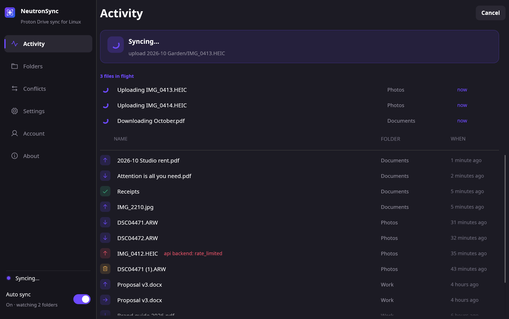
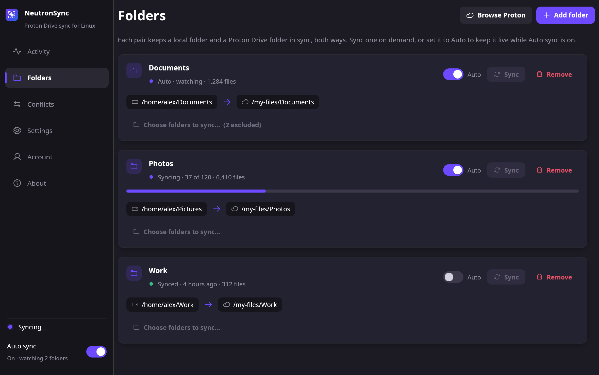
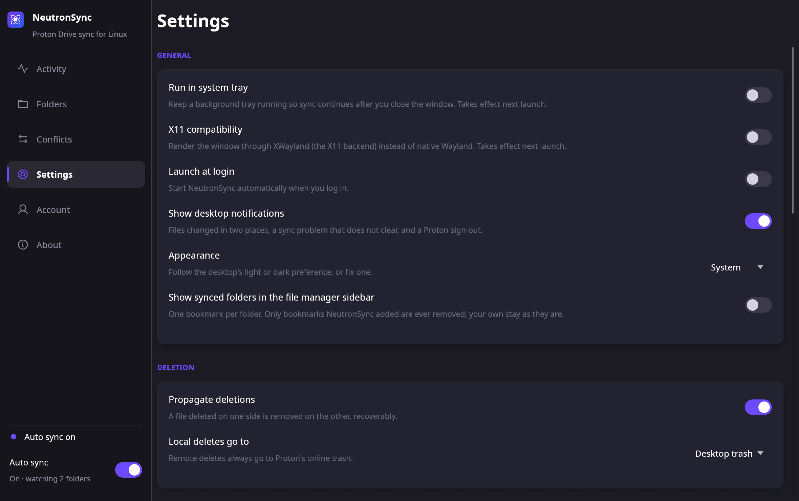
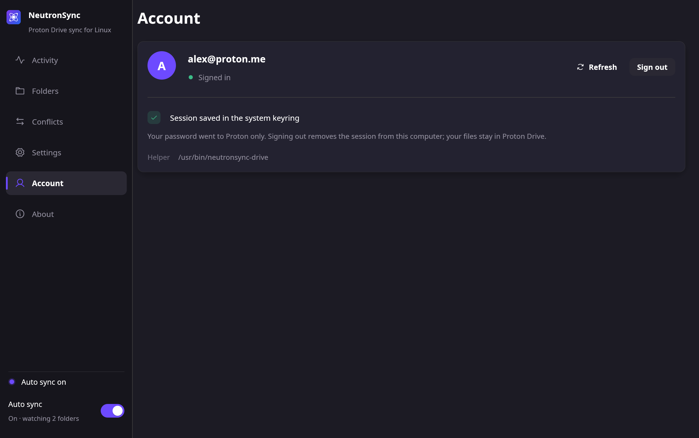
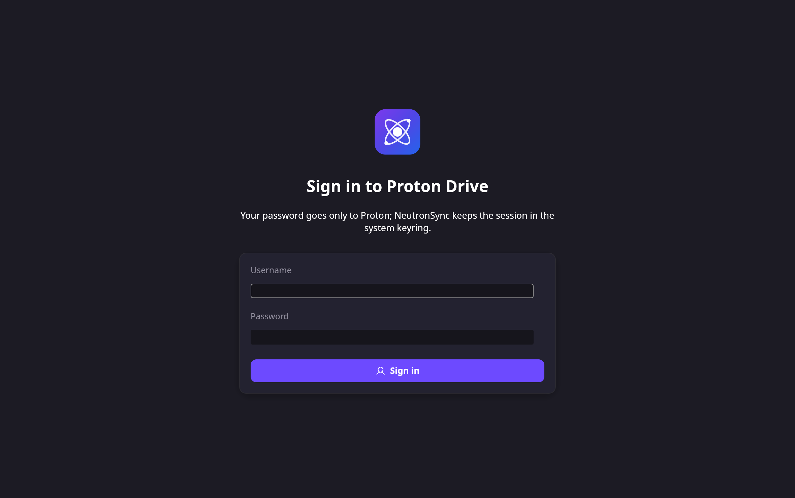
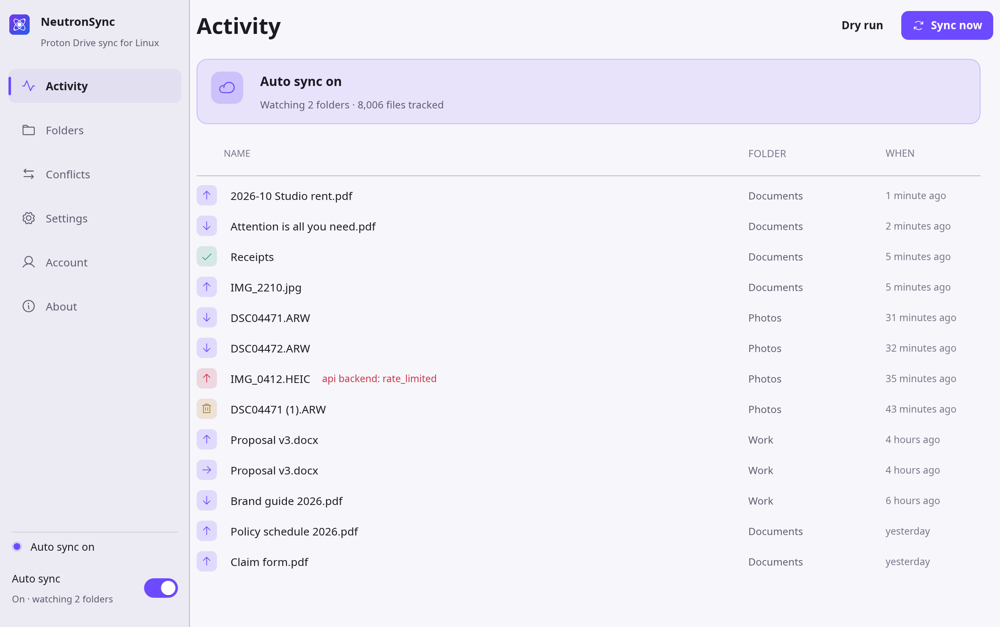
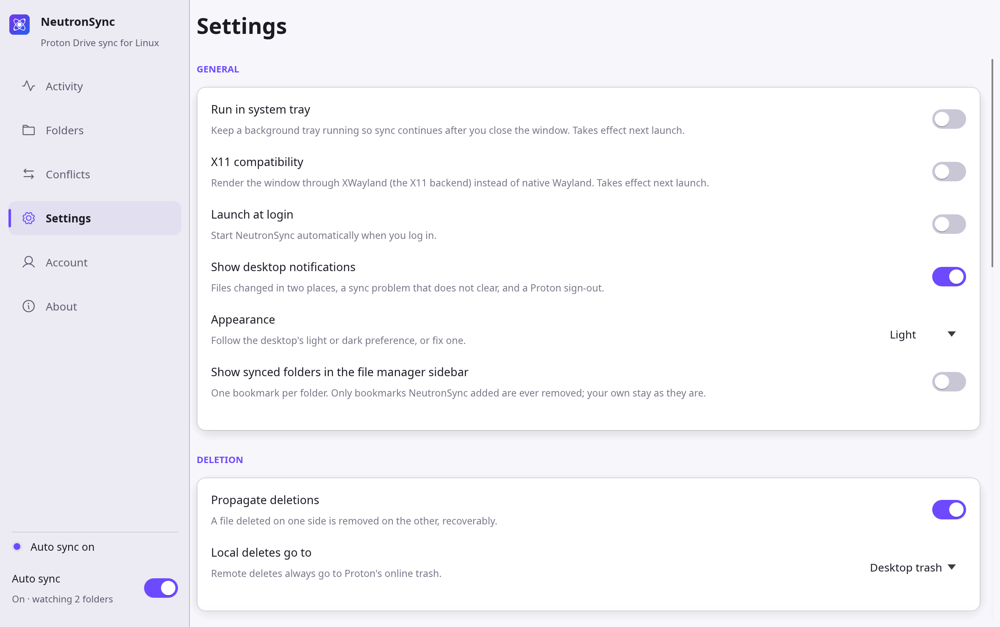

<p align="center">
  
</p>

<h1 align="center">NeutronSync</h1>

<p align="center">
  Bidirectional folder sync for Proton Drive on Linux, with a built-in API sidecar.
</p>

> NeutronSync is an independent, unofficial project. It is not affiliated with, endorsed by, or sponsored by Proton AG. "Proton" and "Proton Drive" are trademarks of Proton AG.

NeutronSync keeps local folders and their Proton Drive counterparts in sync through a three-way-merge engine. Its CLI and native GUI share one core library. The bundled `neutronsync-drive` sidecar uses Proton's SDK and owns the API session.

<p align="center">
  
</p>

## Screenshots

The pictures use example folders and files. See [`docs/screenshots.md`](docs/screenshots.md) for every page, including the sign-in steps.

| Folders | Settings |
| --- | --- |
| [](docs/screenshots/folders.png) | [](docs/screenshots/settings.png) |

| Account | Sign in |
| --- | --- |
| [](docs/screenshots/account.png) | [](docs/screenshots/sign-in.png) |

## Features

- **Proton Drive SDK sidecar.** The packaged `neutronsync-drive` helper talks to Proton through the official Drive SDK. You sign in inside NeutronSync; the session lives in your system keyring.
- **Change feed.** Remote edits on other devices arrive within seconds. Local folders are watched live; only the folders that changed are re-checked. A daily full check is the safety net.
- **Bidirectional three-way merge.** A per-pair baseline lets it tell "new on the remote" apart from "deleted locally", so changes on either side are applied correctly instead of blindly mirrored.
- **Safe by default.** Deletions are opt-in and recoverable (remote to Proton trash, local to the desktop trash). A missing baseline unions both sides rather than mass-deleting. Conflicts keep both copies. An unmounted local folder or a vanished remote base is refused, not mistaken for a mass delete.
- **Selective sync.** Exclude sub-folders per pair. Excluded paths are never touched on Proton; you can optionally free up local space by removing the local copy while the cloud copy stays.
- **Live sync.** A watch daemon reconciles on local change (inotify, debounced) and follows Proton's change feed for remote edits.
- **Native GUI or CLI.** An egui desktop app (single binary, optional system tray) or a lean command-line tool. Same engine, same config.
- **Knows its place on the desktop.** The tray icon shows the sync state and its menu carries a one-line status. Conflicts, a problem that does not clear and a sign-out arrive as desktop notifications. The window follows the desktop's light or dark preference, and synced folders can sit in the file manager sidebar. See [On the desktop](#on-the-desktop).
- **In-app updates.** Checks GitHub releases on a channel you choose (stable or pre-release), then downloads and installs the new version for you: it picks the asset matching how you installed (`.deb` or `.rpm`), installs it through your package manager so your package list stays correct, and restarts the app. A copy that no package manager owns is downloaded for you to install by hand.
- **Signed releases.** Commits and tags are GPG-signed; releases ship `.deb`, `.rpm`, and a portable binary tarball.

## Remote backend

One `neutronsync-drive` sidecar, built on Proton's official Drive SDK, serves the GUI, tray daemon, CLI and watch processes in your user session. Uploads replace same-name files with new revisions and preserve whole-second modification times. Downloads appear atomically after size and SHA-1 verification. Deletes go to Proton trash. Use `--dry-run` to preview a plan. Existing baselines remain valid even when remote node identifiers differ.

```toml
[cli]
sidecar = "/path/to/neutronsync-drive" # optional
```

Without `sidecar`, NeutronSync looks next to its executable, then on `PATH` for `neutronsync-drive`. The package includes it. The `proton-drive` command-line backend was removed in 0.6.0; a config that still sets `[cli] backend = "cli"` is refused with a message saying so.

The first client starts the session owner. Other clients connect to `$XDG_RUNTIME_DIR/neutronsync-drive/session.sock`. If `XDG_RUNTIME_DIR` is unset, the path is `$HOME/.cache/neutronsync-drive/session.sock`. The socket directory is private, mode `0700`; the owner checks peer UIDs. A lock beside the socket prevents competing owners. The sidecar survives its initiating client; after a sidecar crash, clients reconnect and watchers resume persisted event cursors.

Use `neutronsync sync --dry-run` to preview a run. Excludes hide paths and their descendants from the plan, but the sidecar still lists those folders remotely.

## Requirements

- Linux with a recent Rust toolchain (edition 2021) if building from source.
- An unlocked Secret Service keyring in your desktop session and `secret-tool` (`libsecret-tools` on Debian/Ubuntu; `libsecret` on Fedora/RHEL).
- `gio` (from glib, present on most desktops) for recoverable local deletes; a manual XDG-trash fallback is used if it is missing.

## Install

Release packages are built on Ubuntu 22.04 and need glibc 2.35 or newer. They run on Ubuntu 22.04 and later, Debian 12 and later, Linux Mint 21 and later, Fedora 36 and later, and openSUSE Tumbleweed. RHEL 9 and its rebuilds (Rocky, Alma) ship glibc 2.34 and are not supported; build from source there.

### From a release (Debian/Ubuntu)

```sh
# download the .deb from the Releases page, then:
sudo apt install ./neutronsync_<version>_amd64.deb
```

### From a release (Fedora/RHEL)

```sh
sudo dnf install ./neutronsync-<version>.x86_64.rpm
```

Both packages install `neutronsync`, `neutronsync-gui` and `neutronsync-drive` to `/usr/bin`, plus a desktop launcher and systemd user units. They depend on the package providing `secret-tool`. The binary tarball contains all three binaries plus the desktop entry, icons and systemd units; keep the binaries together and provide `secret-tool` and a Secret Service session yourself.

### From the AUR (Arch Linux)

The `neutronsync-bin` package is built from the release tarball and verifies the release signature during the build:

```sh
git clone https://aur.archlinux.org/neutronsync-bin.git
cd neutronsync-bin && makepkg -si
```

Import the release signing key first (`gpg --import packaging/release-signing-key.asc` from this repository), as `makepkg` checks the signature against it.

### Verifying a release

Every release from 0.7.0 on ships `SHA256SUMS` and a signature `SHA256SUMS.asc` made with the project's release signing key (fingerprint `28C582ACB64F9A79563FDBED543CE70174F0FAEA`, see [docs/RELEASE_SIGNING.md](docs/RELEASE_SIGNING.md); during a key rotation two fingerprints are listed here and either may sign). To check a download by hand:

```sh
gpg --import release-signing-key.asc      # packaging/release-signing-key.asc in this repository
gpg --verify SHA256SUMS.asc SHA256SUMS    # must say "Good signature"
sha256sum -c --ignore-missing SHA256SUMS  # "OK" for each file you downloaded
```

The in-app updater makes the same check on its own before installing.

### From source

```sh
# CLI
cargo install --path .                      # -> ~/.cargo/bin/neutronsync
cargo test                                  # engine + unit tests

# Sidecar (Bun 1.4.0)
(cd sidecar && bun install --frozen-lockfile && bun test)
sidecar/build.sh
install -m 755 sidecar/dist/neutronsync-drive ~/.cargo/bin/neutronsync-drive

# GUI (opt-in feature, keeps the CLI dependency-light)
cargo build --release --features gui --bin neutronsync-gui
```

The GUI build needs a few system libraries (Debian/Ubuntu):

```sh
sudo apt-get install -y libgtk-3-dev libxkbcommon-dev libwayland-dev \
  libx11-dev libxcb1-dev libgl1-mesa-dev libayatana-appindicator3-dev
```

## Quick start

### GUI

Launch **NeutronSync** from your app menu. The sign-in page takes your Proton username and password (and two-factor or mailbox password when Proton asks). For human verification, open the verification page, complete it, then select **Retry sign-in**. Password fields stay masked and are cleared after each attempt. The Account page shows whether you are signed in and lets you sign out or refresh. In Settings → Advanced, **Backend** shows which backend is active and **Full check every** sets how often the API safety-net walk runs (6 h, 12 h, 1 day, or 7 days). Add folder pairs on the Folders page and select **Folders to sync** to set exclusions.

### CLI

```sh
neutronsync init                        # write ~/.config/neutronsync/neutronsync.toml
neutronsync login                       # sidecar sign-in; passwords are not echoed
$EDITOR ~/.config/neutronsync/neutronsync.toml
neutronsync sync --dry-run              # preview
neutronsync sync                        # apply
neutronsync watch                       # live sync: FS events + periodic rescan
```

`login` prompts for username, password and any required TOTP or mailbox password. Human verification offers a browser link and waits for confirmation before retrying. `init` writes an empty config; add your own `[[pair]]` entries. `status` reports the account through `auth.status`. `doctor [REMOTE_PATH]` probes the selected backend. `logout` signs out through that backend. `sync` takes `--dry-run`, `--resync` and `--json`; passing pair names syncs only those.

### Web interface

A browser UI in [`web/`](web/) drives the same engine through `neutronsync serve`. It covers Activity, Folders, Conflicts, Settings, Account and About, including Proton sign-in. See [`web/README.md`](web/README.md) for environment variables and how to run it next to the server.

## How it works

For each folder pair, NeutronSync keeps a baseline snapshot of the last state the two sides agreed on. On every run it scans the current local and remote trees and classifies each path against the baseline (created, modified, or deleted) independently per side. Combining the two verdicts decides the action and which side wins.

**Detecting changes.** NeutronSync watches local folders through inotify and receives remote changes from the sidecar's five-second event poll:

- A local change reconciles only the folder whose direct contents changed (one shallow folder listing), not the whole tree. Because the watch is recursive, a change deeper down arrives as its own event and reconciles its own folder, so editing one file never re-walks a subtree.
- Remote events enter the same folder queue as local changes. The watcher maps node UIDs through the baseline or sidecar and reconciles both parents for moves and trash. Events are hints; the three-way merge still decides every change. The watcher saves and acknowledges each cursor after successful reconcile, so restart replays changes made while stopped without a full walk.
- The watcher subscribes before its first full walk. Later full walks handle refresh notices, unresolved events and the daily safety net. Set `[options] full_walk_interval = 86400` to change that interval in seconds. Sign-out pauses sync; sidecar authentication recovery resumes from the saved cursor.

When the background tray is doing the work, an open window mirrors its live state, so scanning and per-file transfers show up in Activity in real time. If that tray exits unexpectedly, NeutronSync starts it again. Quitting from the tray menu stops it. An open window notices within a few seconds and shows when background sync has stopped and is restarting, when it is not responding, or when it could not start. The sync model and its reasoning are written up in [docs/SYNC_MODEL.md](docs/SYNC_MODEL.md).

**Safety model.**

- Deletions propagate only when `propagate_deletes` is on, and recoverably: the remote copy goes to Proton's online trash, the local copy to your desktop trash (`local_delete = "remove"` unlinks permanently instead).
- A missing baseline (first run, or a wiped state dir) unions both sides rather than mirroring, so a lost baseline can't trigger a mass delete.
- If a folder's local root is missing (an unmounted drive) or its remote base folder has vanished, the pair is refused for that run instead of being read as "everything was deleted".
- A failed or interrupted run never poisons the wider sync: the baseline records a file only after its transfer actually completes, so a timeout, an error, or a run cancelled part-way leaves every other file's state untouched and retries the rest next run in the correct direction. This is what stops a half-finished run from later mistaking a not-yet-downloaded file for a deletion.
- Conflicts keep both copies by default (`name (conflict <timestamp>).ext`). Every settled conflict is listed on the window's Conflicts page, with where the copy went, until you dismiss it.
- A run may delete only so many files from one folder pair before it stops and asks: at most `max_delete_files` (default 200) and at most `max_delete_percent` (default 30) of the files that pair keeps in sync, never fewer than 25. Whole folders count the files inside them. Past that, the run holds every deletion back, does everything else, and says so in the window and on the command line. "Restore them" (`neutronsync sync --resync NAME`) brings the files back; "Delete them" (`neutronsync sync --allow-mass-delete NAME`) lets them through for that one run. So an unmounted drive, a stray `rm -rf`, or a folder emptied by mistake cannot wipe the other side.
- A sync state file that is damaged, or was saved by a newer NeutronSync, stops the sync with a message rather than being read as "nothing was ever synced".

## Selective sync

Each pair can list sub-paths to exclude (in the GUI's "Choose folders to sync", or `exclude = [...]` in the config). Excluded paths are ignored entirely and never touched on Proton. Excluding an already-synced folder freezes both copies in place; when you exclude one, NeutronSync offers to remove the local copy (to the desktop trash) to free space while the cloud copy stays. Re-including a folder later re-downloads it from the cloud, so excluding can never delete remote data.

## On the desktop

**Tray.** With "Run in system tray" on, the tray icon tells you what sync is doing without the window: the plain logo when everything is up to date, and a dot in the corner while syncing (purple), when sync is waiting on you (amber: signed out, or the keyring is locked) or when a folder has a problem (red). The menu opens with a status line such as "Up to date · last sync 5 minutes ago", "Syncing 37 of 120" or "Problem in Documents", followed by Open NeutronSync, Sync now and Quit. The tooltip carries the same status.

**Notifications.** Three things arrive as desktop notifications: files that changed in two places (one notice every five minutes at most, summing what arrived in between, with the folder named), a folder whose sync problem has lasted ten minutes (once, until it clears and comes back), and a Proton sign-out (once per sign-out; a locked keyring is not a sign-out). Only the process doing the sync sends them, so an open window never repeats what the tray already said. Turn them off with "Show desktop notifications" in Settings, or `notifications = false`.

**Appearance.** The window follows the desktop's light or dark preference. Settings → Appearance fixes it to Light or Dark instead, and the change applies at once. When the desktop reports no preference, System means dark. The option is `theme = "system" | "light" | "dark"`.

| Activity, light | Settings, light |
| --- | --- |
| [](docs/screenshots/activity-light.png) | [](docs/screenshots/settings-light.png) |

**File manager sidebar.** "Show synced folders in the file manager sidebar" (or `file_manager_bookmarks = true`) keeps one bookmark per synced folder in `~/.config/gtk-3.0/bookmarks`, which Nautilus, Nemo, Thunar and the GTK file dialogs read. The bookmark is named as the folder is in NeutronSync. Adding a folder adds its bookmark, removing one removes it, and turning the switch off removes them all. NeutronSync only ever removes bookmarks it added itself; a bookmark you already had for the same folder is left alone and never claimed.

## Configuration

TOML at `~/.config/neutronsync/neutronsync.toml` (override with `-c PATH` or `$NEUTRONSYNC_CONFIG`). See `neutronsync.example.toml` for the annotated template.

```toml
[cli]
# sidecar = "/path/to/neutronsync-drive"  # optional; else next to neutronsync, then PATH

[options]
remote_root = "/my-files"     # Proton's per-user root
propagate_deletes = false     # deletes cross over (recoverably); false = never delete
local_delete = "trash"        # trash | remove
# max_delete_files = 200      # most files one run may delete from a pair (0 = no cap)
# max_delete_percent = 30     # ... and at most this share of its files, never under 25 (0 = off)
conflict = "keep-both"        # keep-both | newer | skip
compare = "size+mtime"        # size | size+mtime | sha1
full_walk_interval = 86400    # seconds between safety-net full checks (default 1 day)
update_channel = "stable"     # stable | prerelease
# check_on_launch = false     # GUI: check for updates on start (notify only)
# upload_limit_kbps = 0       # upload speed limit in KB/s for all folders (0 = no limit)
# download_limit_kbps = 0     # download speed limit in KB/s for all folders (0 = no limit)
# notifications = true        # GUI: desktop notifications for conflicts, lasting problems, sign-out
# theme = "system"            # GUI: system | light | dark
# file_manager_bookmarks = false  # GUI: one file manager sidebar bookmark per synced folder

[[pair]]
name = "documents"
local = "~/Documents"
remote = "Documents"          # -> /my-files/Documents
# exclude = ["APPS"]          # sub-paths never synced; the Proton copy is untouched
```

## Running in the background (systemd --user)

Use one of these, not both (they'd contend for the same pairs):

```sh
# Live sync (recommended) — the watch daemon:
systemctl --user enable --now neutronsync-watch.service

# or a periodic timer instead:
systemctl --user enable --now neutronsync.timer
```

The packaged units target `/usr/bin/neutronsync`. If you installed with `cargo install`, edit `ExecStart` to `%h/.cargo/bin/neutronsync`. Proton Drive is rate-limited, so keep the sync set modest and the rescan interval sane.

## Headless server

`neutronsync serve` runs the sync engine without a desktop and exposes everything the window can do over a local HTTP API, with live updates as server-sent events. It is meant for a home server or a container, and for a web interface to drive.

```sh
neutronsync serve                                    # http://127.0.0.1:8090/api/v1
NEUTRONSYNC_API_TOKEN=$(head -c 24 /dev/urandom | base64) \
  neutronsync serve --listen 0.0.0.0:8090 --local-root /data
```

Listening on anything but loopback needs an API token of at least 32 characters. Only one NeutronSync may sync a state directory at a time, so stop the desktop tray first. Where there is no keyring, set `session_store = "file"` in `[cli]` and give a key; the Proton session is then kept encrypted in the state directory. [`docs/HTTP_API.md`](docs/HTTP_API.md) lists every endpoint.

## Updates

Releases come from GitHub. Every tag ships as a pre-release; a stable release is one that has been promoted after the build has proven itself, and its title says `(stable)`. The newest promoted release is the one GitHub marks "Latest". Point the updater at the `stable` or `prerelease` channel in Settings (or `update_channel` in the config): `stable` offers only promoted releases, `prerelease` offers every build as it lands. Checking never installs anything. When an update is available, "Download and install" verifies the download against the release's signed checksum list (every release from 0.7.0 on) and the checksum GitHub publishes, then installs it through your package manager (one `pkexec` prompt) and offers to restart. A download that fails either check is discarded. `neutronsync --version` and the About page show the commit a build was made from, so a bug report can name it.

## Privacy and trust

The API sign-in form passes credentials over the private local socket to the sidecar. The sidecar stores session tokens and the derived key passphrase in your Secret Service keyring. Passwords, TOTP codes and tokens never enter logs, configuration, activity history or process arguments. One process owns and refreshes the session. Existing phase-labelled sessions migrate automatically to `NeutronSync Drive session`. See [SECURITY.md](SECURITY.md) for the threat model.

## Troubleshooting

- **Sign-in service didn't start:** the GUI shows this when `neutronsync-drive` cannot be started or reached. Reinstall the package, or build `sidecar/` and place `neutronsync-drive` beside the Rust binaries or on `PATH`, or set `cli.sidecar`. Check the socket under `$XDG_RUNTIME_DIR/neutronsync-drive/` (or `$HOME/.cache/neutronsync-drive/` when `XDG_RUNTIME_DIR` is unset).
- **`secret-tool` missing:** install `libsecret-tools` on Debian/Ubuntu or `libsecret` on Fedora/RHEL.
- **Keyring locked / no Secret Service:** start and unlock your desktop keyring. Run NeutronSync in the same user D-Bus session. A headless service needs that session too.
- **Human verification:** complete the shown Proton verification link, then retry sign-in. The CLI `login` command waits for Enter before retrying.
- **Signed out:** sign in from Account or run `neutronsync login`. Refresh the Account page if needed. The watcher resumes from its saved event cursor.
- **Sidecar path differs:** all clients in one user session must select the same executable. Align `cli.sidecar` before reconnecting.
- **Reading sync.log:** under the configured `state_dir` (default `~/.local/state/neutronsync/sync.log`). Timestamps are UTC.

## Known limitations

- Remote changes arrive through the sidecar's event poll, every five seconds, not instantly.
- Default `compare = "size+mtime"` can miss an in-place edit that keeps the same size and mtime; use `compare = "sha1"` to compare content exactly.
- Renames look like a delete + create.

## Development

See [`CONTRIBUTING.md`](CONTRIBUTING.md) for layout, build, and release notes, and [`docs/GUI_API.md`](docs/GUI_API.md) for the GUI backend API. `scripts/screenshots.sh` regenerates the documentation screenshots from example data in a private X server.

## License

MIT. See [`LICENSE`](LICENSE).
